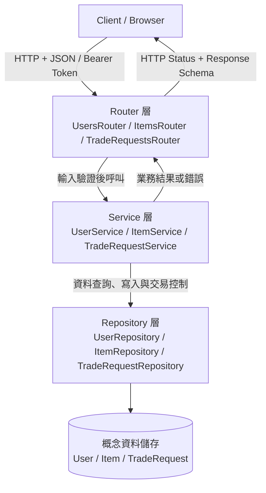
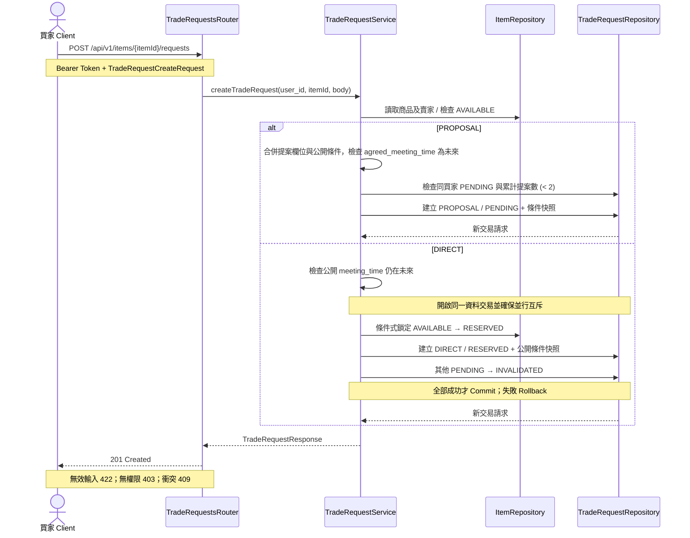
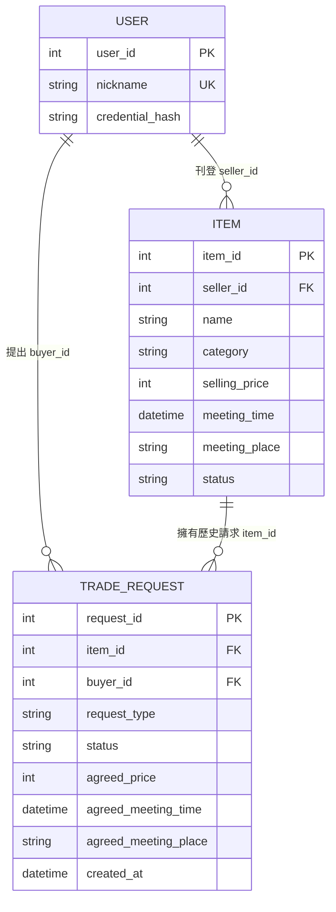

# 04｜系統架構與資料模型（Architecture & Data Model）

> **專案：** 校園二手物交易與預約平台    
> **專案狀態：** Design Only（僅規劃，未實作程式碼、資料庫或測試）  

## 1. 架構目標與範圍

本服務聚焦一條校園二手物交易流程：**刊登商品 → 查詢交易條件 → 直接預約／提出交易提案 → 成功鎖定商品 → 取消或完成線下面交**。其核心亮點是：不論買家直接預約，或賣家接受交易提案，同一件商品在同一時間**至多只有一筆有效 `RESERVED` 交易請求**。

本次只規劃 HTTP／JSON 介面、分層職責、交易流程與概念資料模型；不實作實際後端、資料庫、聊天室、金流、物流、背景排程或測試。

- **對外 API 前綴：** `/api/v1`；OpenAPI `servers.url` 使用 `/api/v1`，`paths` 為相對路徑。
- **使用者識別：** `POST /users` 建立全站唯一暱稱與隨機操作憑證；受保護操作採 `Authorization: Bearer <opaque-token>`。伺服器僅保存憑證雜湊。
- **日期時間：** 對外以 `Asia/Taipei`（UTC+08:00）RFC 3339 表示，例如 `2026-12-05T15:00:00+08:00`；刊登／更新時間、建立直接預約、建立提案（合併條件後）及接受提案（快照）檢查未來有效；拒絕／撤回／取消／完成不受逾時限制。儲存層可以使用可正確還原時區的時間型別，但回應仍遵循契約。
- **金額：** 正整數新臺幣；`original_price` 可為 `null`，未經憑據查證。

## 2. 分層架構（Router → Service → Repository）

| 層級 | 主要責任 | 不應承擔的工作 |
|---|---|---|
| **Router** | 對應 Method／Path；解析 Path、Query、Body；套用 OpenAPI 欄位格式；讀取並驗證 Bearer 憑證、取得呼叫者身分；將結果及例外轉成 HTTP Status／JSON。 | 不直接操作資料表、不自行決定預約優先權。 |
| **Service** | 執行 FR／BR：擁有者檢查、交易條件驗證、最多兩次提案、狀態轉換及鎖單；協調跨 Entity 的原子性交易。 | 不將原子性保障寄託在單純的「先查詢、後更新」。 |
| **Repository** | 依識別碼查詢、篩選、建立、局部更新資料；在同一交易範圍內執行條件式更新／鎖定並落實 PK、FK、UNIQUE 等限制。 | 不判斷「誰可以接受提案」等業務權限。 |

**分層原則：** Router 負責傳輸與身分入口；Service 負責交易規則；Repository 負責持久化及必要的資料一致性。`ErrorResponse` 統一由 Router／錯誤處理機制回傳，不另建立 `Error` Entity。

### 2.1 三組功能元件與 API 對應

| Router／Service／Repository | API Operations | 主要用途 | 主要 Entity |
|---|---|---|---|
| `UsersRouter` → `UserService` → `UserRepository` | `POST /users` | 唯一暱稱、高熵憑證與使用者建立 | `User` |
| `ItemsRouter` → `ItemService` → `ItemRepository` | `POST /items`、`GET /items`、`PATCH /items/{itemId}` | 刊登、篩選、編輯及公開交易條件保護 | `Item`；查驗 `TradeRequest` 是否有 `PENDING` |
| `TradeRequestsRouter` → `TradeRequestService` → `TradeRequestRepository`（協調 `ItemRepository`） | `POST /items/{itemId}/requests`、`GET /items/{itemId}/requests`、`PATCH /requests/{requestId}` | 提案額度、買賣雙方存取、預約鎖單與狀態轉換 | `TradeRequest`、`Item`、`User` |

> 上表僅分組現有 **7 條**操作，未新增 Router API 或 Entity。公開商品資料由 `GET /items` 提供，不規劃 `GET /items/{itemId}`；交易請求以指定商品的清單查詢，不增加獨立單筆查詢 API。

## 3. 核心 API Request Flow

### 3.1 核心範例：`POST /items/{itemId}/requests`（API-05／FR-04）

此 API 依 `request_type` 處理兩條**同一交易請求資源**的分支：`DIRECT` 直接預約；`PROPOSAL` 建立待處理交易提案。對應 OpenAPI：`TradeRequestCreateRequest`（`oneOf`：`DirectTradeRequestInput`／`ProposalTradeRequestInput`），成功回應 `TradeRequestResponse`。

**文字步驟與狀態判斷：**

1. **Router：** 解析 `itemId`（正整數）、Bearer Token、JSON Body；依 `TradeRequestCreateRequest` 驗證 `DIRECT`／`PROPOSAL` 結構。格式不合法回 `422`；憑證無效回 `401`。
2. **Service 共通檢查：** 取得當前使用者與商品，確認商品存在（否則 `404`）、呼叫者不是賣家（否則 `403`），且商品為 `AVAILABLE`（否則 `409`）。**此時不先驗證公開面交時間**，而是在判別 `DIRECT`／`PROPOSAL` 後檢查各自的有效時間。
3. **`PROPOSAL` 分支：** 先合併選填提案與公開條件，確認 `agreed_meeting_time` 為未來；即使公開時間已過，只要提案改成未來時間就可繼續（若仍為過去時間則 `422`）。至少提出一項與公開條件不同的調整；若有改價，`0 < proposed_price < selling_price`；地點非空白。利用 `TradeRequestRepository` 檢查同買家同商品累計 `PROPOSAL` 少於 2，且目前沒有該買家的 `PENDING`。通過後建立 `PROPOSAL`、`PENDING`，保存 `proposed_*` 及完整的 `agreed_*` 條件快照；商品仍 `AVAILABLE`。
4. **`DIRECT` 分支：** 只能傳 `request_type: DIRECT`，完整採用商品公開條件，須確認公開 `meeting_time` 仍在未來（否則 `422`）。在**同一原子性資料交易**中，條件式鎖定 Item（`AVAILABLE → RESERVED`）、建立 `DIRECT/RESERVED` 的 `TradeRequest`，並將該商品其他 `PENDING` 提案改成 `INVALIDATED`。若其他交易已先鎖單，整筆回滾並回 `409`；成功則 `201`。
5. **回應：** Router 按 `TradeRequestResponse` 回傳 `request_id`、狀態、`agreed_*` 等欄位。`PROPOSAL` 回 `PENDING`、`DIRECT` 回 `RESERVED`。

**補充：賣家接受提案的鎖單流程。** `PATCH /requests/{requestId}`（API-07，`{"status":"RESERVED"}`）只能由商品賣家對 `PENDING/PROPOSAL` 執行；Service 確認商品仍 `AVAILABLE`、提案快照的面交時間仍在未來，再以同一交易更新該請求與 Item 為 `RESERVED`，並使其他 `PENDING` → `INVALIDATED`。這與直接預約**共用同一原子性鎖單規則**；競爭失敗為 `409 Conflict`（FR-05、BR-09、BR-10）。但拒絕／撤回過期提案、取消或完成已過面交時間的有效預約，均不需再檢查時間為未來。若公開時間已過且有 `PENDING`，須先拒絕所有待處理提案或由買家撤回，才能修改公開面交時間；已用額度不返還。

### 3.2 原子性與防重複鎖單設計

**設計約束：** 同一商品在任何時刻至多存在一筆 `TradeRequest.status = RESERVED`，且 `Item.status = RESERVED` 必須對應該筆有效請求。

- **交易邊界：** 鎖定 Item、建立或更新有效 TradeRequest、使其他 `PENDING` 失效，必須視為單一交易；任一步失敗全部回滾。
- **並行控制：** Repository 必須提供原子性條件更新（僅在 `Item.status = AVAILABLE` 時轉為 `RESERVED`）或等效的列鎖定方案；資料層另建議對同一 `item_id` 的 `RESERVED` 請求施加唯一性限制，作為第二道保障。**建立 `PROPOSAL` 與建立 `DIRECT` 也應對同一商品協調互斥或在寫入前重新確認狀態**，避免直接預約剛完成鎖單／使待處理提案失效後，另一個並行請求才插入新的 `PENDING`。
- **結果：** 第一個成功提交的預約取得鎖定；其他競爭操作回 `409 Conflict`，不可產生第二筆 `RESERVED`，也不可留下半完成的交易。
- **取消／完成：** `PATCH /requests/{requestId}` 從 `RESERVED` → `CANCELLED` 時，同交易將商品改回 `AVAILABLE`；→ `COMPLETED` 時將商品改為 `SOLD`。歷史請求保留，不覆寫也不重新啟用。
- **提案額度與編輯衝突：** 累計兩次提案及同買家最多一筆 `PENDING`，須在並行建立提案時仍成立；賣家修改公開交易條件也必須與檢查是否存在 `PENDING` 的步驟一致化，避免同時建立提案與修改價格造成舊條件提案。

> 本段描述未來實作所需的交易一致性，不代表目前已經建立資料庫索引或完成並行測試。

### 3.3 其他狀態轉換及權限

| Request 目前狀態 | 目標狀態 | 操作者 | Item 結果 |
|---|---|---|---|
| `PENDING`（`PROPOSAL`） | `RESERVED` | 商品賣家 | `AVAILABLE → RESERVED`，其他 `PENDING → INVALIDATED` |
| `PENDING` | `REJECTED` | 商品賣家 | 維持 `AVAILABLE` |
| `PENDING` | `WITHDRAWN` | 提案買家 | 維持 `AVAILABLE` |
| `RESERVED` | `CANCELLED` | 該請求買家或商品賣家 | `RESERVED → AVAILABLE` |
| `RESERVED` | `COMPLETED` | 商品賣家 | `RESERVED → SOLD` |

`INVALIDATED` 僅由鎖單流程自動設定，不允許透過 API 指定；所有終止狀態均不可再轉換。交易請求內容僅商品賣家與該提案買家可讀取（賣家查該商品全部，其他人只看自己的），並由 Service 依操作身分執行授權。

## 4. 資料模型（3 個主要 Entity）

### 4.1 Entity Relationship Diagram（概念 ERD）

> ERD 僅顯示代表性欄位以維持可讀性；**完整核心 Attributes 見下表**。概念上 `User 1:N Item`、`User 1:N TradeRequest`、`Item 1:N TradeRequest`（包含歷史）；但同一商品同一時間最多一筆有效 `RESERVED` 請求。

### 4.2 `User`（使用者）

| Attribute | 型別／識別 | 必填 | 說明 |
|---|---|---|---|
| `user_id` | 正整數，**PK** | 是 | 系統產生的使用者 ID；建立回應含此欄位。 |
| `nickname` | 字串，**UNIQUE**，2–30 字元 | 是 | 公開暱稱；不可重複，衝突 `409`。 |
| `credential_hash` | 字串（憑證雜湊） | 是 | 僅儲存高熵隨機 Token 的雜湊；不儲存明文。 |

`access_token` **不是資料庫 Attribute**：它是在 `POST /users` 成功時回傳一次的明文操作憑證；其他受保護 API 以 Bearer Token 查驗身份，不傳 `user_id` 來指定操作者。

### 4.3 `Item`（商品）

| Attribute | 型別／識別 | 必填 | 說明 |
|---|---|---|---|
| `item_id` | 正整數，**PK** | 是 | 商品識別碼，對應路徑 `{itemId}`。 |
| `seller_id` | 正整數，**FK → User.user_id** | 是 | 發布者，由 Token 識別取得。 |
| `name` | 非空字串 | 是 | 商品名稱。 |
| `category` | enum 字串 | 是 | `TEXTBOOK`／`APPLIANCE`／`DAILY_GOODS`。 |
| `description` | 非空字串 | 是 | 商品物況描述。 |
| `department` | 字串／`null` | 否 | 適用系所，可供篩選。 |
| `course_name` | 字串／`null` | 否 | 課程名稱，可供篩選。 |
| `selling_price` | 正整數（NT$） | 是 | 公開二手售價。 |
| `original_price` | 正整數／`null`（NT$） | 否 | 賣家自填原價，未查證。 |
| `meeting_time` | 日期時間 | 是 | 未來面交時間；對外 `+08:00`。 |
| `meeting_place` | 非空字串 | 是 | 面交地點。 |
| `status` | enum 字串 | 是 | `AVAILABLE`／`RESERVED`／`SOLD`；初始 `AVAILABLE`。 |

**衍生值（不另儲存）：** `price_ratio_percent = selling_price / original_price × 100`；若 `original_price = null`，回傳 `null`。它屬於 `ItemResponse` 的計算欄位，不是第四個 Entity。

**修改限制：** `PATCH /items/{itemId}` 只允許商品賣家修改 `AVAILABLE` 商品；若有任何 `PENDING` 提案，不得**變更** `selling_price`、`meeting_time`、`meeting_place`（`409`），其餘一般資料仍可修改。`item_id`、`seller_id` 與 `status` 不由此 API 直接修改。

### 4.4 `TradeRequest`（交易請求與預約）

| Attribute | 型別／識別 | 必填 | 說明 |
|---|---|---|---|
| `request_id` | 正整數，**PK** | 是 | 交易請求識別碼，對應 `{requestId}`。 |
| `item_id` | 正整數，**FK → Item.item_id** | 是 | 所屬商品。 |
| `buyer_id` | 正整數，**FK → User.user_id** | 是 | 提案或預約買家，由 Token 識別取得。 |
| `request_type` | enum 字串 | 是 | `DIRECT`／`PROPOSAL`。 |
| `status` | enum 字串 | 是 | `PENDING`／`REJECTED`／`WITHDRAWN`／`INVALIDATED`／`RESERVED`／`CANCELLED`／`COMPLETED`。 |
| `proposed_price` | 正整數／`null` | 否 | 買家要求調整的價格；`DIRECT` 為 `null`。 |
| `proposed_meeting_time` | 日期時間／`null` | 否 | 買家要求調整的面交時間；`DIRECT` 為 `null`。 |
| `proposed_meeting_place` | 字串／`null` | 否 | 買家要求調整的面交地點；`DIRECT` 為 `null`。 |
| `agreed_price` | 正整數（NT$） | 是 | 建立請求時的完整有效價格快照。 |
| `agreed_meeting_time` | 日期時間 | 是 | 建立請求時的完整有效時間快照。 |
| `agreed_meeting_place` | 非空字串 | 是 | 建立請求時的完整有效地點快照。 |
| `created_at` | 日期時間 | 是 | 請求建立時間，對外為臺北時間。 |

`agreed_*` 為與既有 OpenAPI 一致的欄位名稱：**`PENDING` 時代表「待賣家接受的完整交易條件」，進入 `RESERVED` 後才是「成立的交易條件」**。省略的 `proposed_*` 會在建立請求時計算並填入對應的 `agreed_*`，原始提案欄位可維持 `null`。這樣不必另設 `Offer`、`Reservation` 兩個資料表。

### 4.5 Relationships 與必要的完整性限制

| 編號 | 關聯／限制 | 設計目的 |
|---|---|---|
| R-01 | `Item.seller_id` **FK → `User.user_id`**（User 1:N Item） | 每件商品都有明確賣家。 |
| R-02 | `TradeRequest.buyer_id` **FK → `User.user_id`**（User 1:N TradeRequest） | 每筆交易請求都能追溯買家。 |
| R-03 | `TradeRequest.item_id` **FK → `Item.item_id`**（Item 1:N TradeRequest） | 保留多筆歷史交易請求。 |
| R-04 | `User.nickname` **UNIQUE**；`credential_hash` 應避免重複 | 防止暱稱衝突並維持操作識別。 |
| R-05 | 每個 `item_id` **最多一筆 `status = RESERVED`** 的 TradeRequest | 防止重複鎖單；可由條件式唯一索引或等效機制保障。 |
| R-06 | 同一 (`item_id`, `buyer_id`) **最多一筆 `PENDING`**，`PROPOSAL` 歷史成功建立數量 ≤ 2 | 遵守提案次數規則；須在並行操作中一致檢查。 |
| R-07 | `buyer_id ≠ Item.seller_id`；`DIRECT` 不含 `proposed_*`；`PROPOSAL` 至少有一項有效變更 | 阻止賣家預約自身商品、維持請求型別一致。 |
| R-08 | `Item.status` 與其有效 `TradeRequest.status` 必須在同一交易同步變更 | 避免商品狀態與請求狀態矛盾。 |

`R-06` 的「最多兩筆歷史 `PROPOSAL`」是業務數量限制，無須新增計數 Entity，Service 可以查詢 `TradeRequest` 的歷史筆數並在交易控制下判斷。`R-05`／`R-06` 列出的是**設計上應實現的約束**，非聲稱已建立實體資料庫或索引。

## 5. 需求追溯（Traceability）

### 5.1 完整的核心追溯範例：直接預約

| 追溯層級 | 對應項目 | 說明 |
|---|---|---|
| **FR** | `FR-04`／`AC-04a`；`BR-09`、`BR-10` | 直接預約成功時，商品與請求同步變成 `RESERVED`，同商品不能重複鎖定。 |
| **API** | **API-05**：`POST /api/v1/items/{itemId}/requests` | 以 `POST` 建立商品下的 `TradeRequest`。 |
| **OpenAPI Schema** | `TradeRequestCreateRequest` → `DirectTradeRequestInput`；`TradeRequestResponse`／`ErrorResponse` | Request `{ "request_type": "DIRECT" }`；成功 `201`，衝突 `409`。 |
| **Component** | `TradeRequestsRouter` → `TradeRequestService` → `ItemRepository` + `TradeRequestRepository` | Router 驗證；Service 檢查規則；Repository 在同一交易中鎖單與保存。 |
| **Entity** | `Item`（`item_id`, `status`）；`TradeRequest`（`request_id`, `item_id`, `buyer_id`, `request_type`, `status`, `agreed_*`）；`User`（買家身份） | 由 Item／TradeRequest 的 PK、FK、狀態與快照支援業務規則。 |

**可串接的追溯鏈：**  
`FR-04 → API-05 POST /items/{itemId}/requests → TradeRequestCreateRequest / DirectTradeRequestInput / TradeRequestResponse → TradeRequestsRouter → TradeRequestService → ItemRepository + TradeRequestRepository → Item + TradeRequest（關聯 User）`

### 5.2 其餘 FR 與 API、元件對應

| FR | API | 核心 OpenAPI Schema | 主要 Service | Entity |
|---|---|---|---|---|
| `FR-01` | `POST /users` | `CreateUserRequest`、`CreateUserResponse` | `UserService` | `User` |
| `FR-02` | `POST /items`、`PATCH /items/{itemId}` | `CreateItemRequest`、`UpdateItemRequest`、`ItemResponse` | `ItemService` | `Item`、`User` |
| `FR-03` | `GET /items` | `ItemListResponse`、`ItemResponse` | `ItemService` | `Item` |
| `FR-04` | `POST /items/{itemId}/requests` | `TradeRequestCreateRequest`、`TradeRequestResponse` | `TradeRequestService` | `TradeRequest`、`Item` |
| `FR-05` | `GET /items/{itemId}/requests`、`PATCH /requests/{requestId}` | `TradeRequestListResponse`、`TradeRequestUpdateRequest`、`TradeRequestResponse` | `TradeRequestService` | `TradeRequest`、`Item` |
| `FR-06` | `PATCH /requests/{requestId}` | `TradeRequestUpdateRequest`、`TradeRequestResponse` | `TradeRequestService` | `TradeRequest`、`Item` |

所有 Schema 名稱均沿用 `03-openapi.yaml` 的 `components.schemas`；`ItemCategory`、`ItemStatus`、`TradeRequestType`、`TradeRequestStatus`、`TaipeiDateTime`、`PositivePrice` 為共用型別／約束，不是額外的資料實體。

## 6. 文件一致性與本次取捨

| 核對項目 | 本文件採用的設計 | 依據 |
|---|---|---|
| 功能規模 | 7 條 API、3 個 Entity，不新增訊息／訂單資源 | README、02 第 2、8 節 |
| 商品與請求狀態 | `Item`：3 種；`TradeRequest`：7 種 | 01 第 6 節、OpenAPI enum |
| 提案上限 | 同買家／同商品最多 2 筆 `PROPOSAL`，不返還次數 | FR-04、BR-05 |
| 商品修改限制 | 有 `PENDING` 時不得變更公開售價、時間、地點 | FR-02、BR-07 |
| 成功鎖單 | 直接預約或賣家接受提案均更新 `Item` 與 `TradeRequest` | FR-04、FR-05、BR-09～BR-10 |
| 取消及完成 | 買家／賣家可取消；僅賣家可完成；歷史保留 | FR-06、BR-11 |
| 日期時間 | `Asia/Taipei`（`+08:00`）；建立／接受預約檢查對應有效時間，結案與撤回／拒絕不受逾時限制 | BR-04、OpenAPI `TaipeiDateTime` |
| 對外資料 | 只回傳公開 Item 欄位、當事人有權讀取的請求 | BR-08、Item／TradeRequest Response |

**本次刻意不做：** 公開問答、預約後私訊、金流、物流、圖片上傳、帳號復原、校園 SSO、自動到期及通知。系統只提供明確的價格／面交時間／地點與交易狀態，買賣雙方依約線下面交；無法履約則取消預約。

> **備註：** 所有 Router、Service、Repository、交易約束及 ERD 均屬未來實作指引。本次未建立資料庫，也未宣稱 API 或測試已完成。
